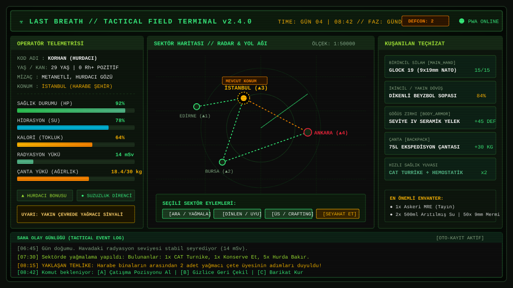
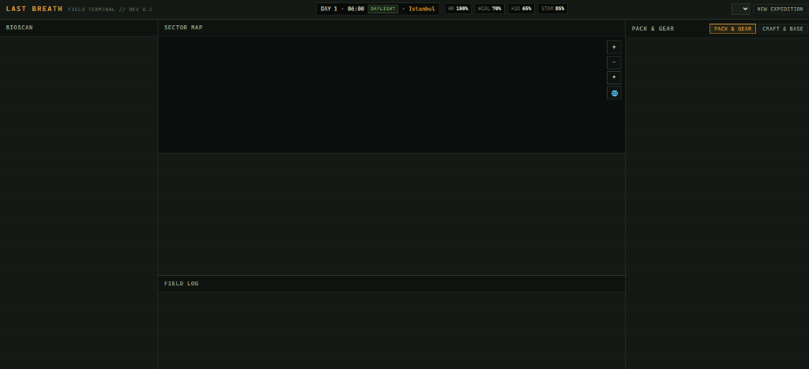

# ☣️ LAST BREATH // SON NEFES
### *Taktiksel Kıyamet Sonrası Hayatta Kalma ve Saha Telemetrisi Simülasyonu*

[](./manifest.webmanifest)
[](#)
[-blue?style=flat-square)](#)
[](#)
[](#)

<p align="center">
  
</p>

---

## 📌 İçindekiler
1. [Oyun Hakkında & Evren](#-oyun-hakk%C4%B1nda--evren)
2. [Öne Çıkan Temel Özellikler](#-öne-%C3%A7%C4%B1kan-temel-özellikler)
3. [Ekran Görüntüleri & Görsel Arayüz](#-ekran-görüntüleri--görsel-arayüz)
4. [Oyun Mekanikleri](#-oyun-mekanikleri)
   - [Karakter Oluşturma & Kimlik](#1-karakter-olu%C5%9Fturma--kimlik)
   - [Harita & Sektör Keşfi](#2-harita--sektör-ke%C5%9Ffi)
   - [530+ Gerçekçi Eşya Kataloğu](#3-530-ger%C3%A7ek%C3%A7i-e%C5%9Fya-katalo%C4%9Fu)
   - [İnteraktif Yağma ve Arama (Loot Modal)](#4-%C4%B0nteraktif-ya%C4%9Fma-ve-arama-loot-modal)
   - [Sıra Tabanlı Taktiksel Çatışma](#5-s%C4%B1ra-tabanl%C4%B1-taktiksel-%C3%A7at%C4%B1%C5%9Fma)
   - [Sığınak İnşası & Üretim (Crafting)](#6-s%C4%B1%C4%9F%C4%B1nak-%C4%B0n%C5%9Fas%C4%B1--%C3%9Cretim-crafting)
5. [Çoklu Kayıt Sistemi (10 Slot // 2 Ücretsiz, 8 Premium)](#-multi-slot-kay%C4%B1t-sistemi)
6. [Mobil Uyum & PWA (Progressive Web App)](#-mobil-uyum--pwa-deste%C4%9Fi)
7. [Teknoloji Yığını & Mimari](#-teknoloji-y%C4%B1%C4%9F%C4%B1n%C4%B1--mimari)
8. [Dizin Yapısı](#-dizin-yap%C4%B1s%C4%B1)
9. [Kurulum ve Çalıştırma](#-kurulum-ve-%C3%A7al%C4%B1%C5%9Ft%C4%B1rma)
10. [Katkıda Bulunma & Lisans](#-katk%C4%B1da-bulunma--lisans)

---

## 📻 Oyun Hakkında & Evren

**Last Breath (Son Nefes)**, nükleer ve biyolojik çöküş sonrası ıssızlaşan Avrasya ve Akdeniz havzasında geçen, gerçek dünya coğrafyası üzerine kurulu taktiksel bir hayatta kalma RPG simülasyonudur.

Oyuncu; çökmüş metropoller, radyasyonlu bataklıklar, terkedilmiş askeri üsler ve yağmacı çetelerin kol gezdiği sektörler arasında seyahat eder. Hayatta kalmak için açlık, susuzluk, bitkinlik, vücut ısısı ve radyasyon gibi hayati telemetrileri dengede tutmalı; 530'dan fazla gerçekçi eşyayı toplayıp zanaat yapmalı ve kendi sığınağını inşa etmelidir.

---

## 🌟 Öne Çıkan Temel Özellikler

- **Retro-Terminal Askeri Arayüz:** Amber, zeytin yeşili ve pas kırmızısı tonlarında; CRT tarama çizgileri ve dinamik sinyal telemetrisiyle donatılmış atmosferik kullanıcı arayüzü.
- **Sıfır Harici Çalışma Bağımlılığı (Zero Runtime Dependencies):** React, Vue veya harici bir kütüphane olmaksızın, tamamen saf modern JavaScript (ES Modules) ve saf CSS ile geliştirilmiştir.
- **Dinamik Hava & Termal Simülasyon:** Asit yağmuru, radyoaktif kül sisi, sıfırın altında soğuk cephe ve fırtınalar; çekirdek vücut ısısı (hipotermi), titreme kalori kaybı, kimyasal yanıklar ve taktik fenerin gizlilik riski (%300 pusu tehdidi).
- **Hedefli Anatomik Travma Şeması:** 6 ayrı uzuvda kırık, atardamar kanaması, göğüs pnömotoraksı ve enfeksiyon takibi; CAT turnike, göğüs mührü, SAM ateli ve siprofloksasin ile klinik tedavi.
- **Fraksiyon Diplomasisi & Dinamik Karşılaşmalar:** Demir Muhafızlar, Göçebe Loncası ve Kül Yağmacıları arasında -100 ile +100 arası itibar, takas indirimleri ve haraç/çatışma kararları.
- **530+ Gerçekçi Eşya:** Tıbbi cerrahi gereçlerden geniş spektrumlu antibiyotiklere, 12 kalibre pompalı tüfeklerden Seviye IV seramik hücum yeleklerine kadar zengin envanter.
- **İnteraktif Yağma Penceresi:** Arama (scavenge) işlemlerinde bulunan eşyaları ağırlık limitine göre tek tek seçip çantaya alma imkanı.
- **Çoklu Kayıt Yuvaları (10 Slot):** 2 adet ücretsiz ve 8 adet Survivor Premium kayıt yuvası.
- **Progressive Web App (PWA):** Android, iOS ve masaüstünde doğrudan "Ana Ekrana Ekle" desteği; Service Worker sayesinde internetsiz tam ekran çalışabilme.
- **Anlık İki Dilli Mimari (TR / EN):** Sayfa yenilemeye gerek kalmadan tüm arayüz, loglar, eşyalar ve mekanikler arasında Türkçe ve İngilizce geçişi.

---

## 📸 Ekran Görüntüleri & Görsel Arayüz

Oyun, nükleer kıyamet sonrası sahra bilgisayarlarının monokromatik yeşil-kehribar CRT ekran estetiğini modern mobil ve masaüstü tarayıcılara taşır.

| 🖥️ Masaüstü Taktiksel Terminal & Radar Haritası | 📱 Mobil Uyumlu Saha Telemetrisi & HUD |
| :---: | :---: |
|  |  |
| *Masaüstü: Vektörel sektör ağı, radar, biyo-telemetri ve olay günlüğü* | *Mobil: Kompakt telemetri, taşmayan hayati göstergeler ve PWA kurulumu* |

> 💡 **CRT & Terminal Deneyimi:** Oyun; tarama çizgileri (scanlines), fosfor ışıması ve retro tipografiyle tasarlanmıştır. En yüksek atmosfer için tarayıcınızı tam ekrana (`F11`) alabilir veya mobil cihazınızda PWA olarak ana ekrana ekleyebilirsiniz.

---

## 🎮 Oyun Mekanikleri

### 1. Karakter Oluşturma & Kimlik
Yeni sefere başlarken 4 aşamalı detaylı bir karakter hazırlığı yapılır:
- **Kimlik (Identity):** İsim belirleme (veya rastgele kıyamet isimleri üretici).
- **Yaş Dinamiği:** 18 ile 65 yaş aralığı.
  - *Genç (18–25):* Yüksek kondisyon, hızlı stamina rejenerasyonu.
  - *Olgun (26–40):* Dengeli metanet, güç ve çeviklik.
  - *Kıdemli (41–65):* Hayatta kalma tecrübesi, daha yüksek arama ve üretim verimi.
- **Kan Grubu:** A+, A-, B+, B-, AB+, AB-, 0+, 0- (Tıbbi müdahalelerde kritik rol oynar).
- **Mizaçlar (Traits):** *Stoic* (Metanetli), *Scavenger* (Hurdacı Gözü), *Medic* (Sıhhiye), *Athlete* (Atletik), *Insomniac* (Az Uyuyan), *Packmule* (Yükçü).
- **Geçmiş Arketipi:**
  - **Hurdacı (Scavenger):** Levye, sırt çantası ve temel tamir kiti ile başlar.
  - **Askeri Kaçak (Soldier):** Hizmet tabancası, mühimmat ve taktik yelek ile başlar.
  - **Sıhhiyeci (Medic):** İlk yardım kiti, cerrahi neşter ve antibiyotiklerle başlar.
  - **Hayatta Kalan (Survivor):** Dayanıklı ceket, av bıçağı ve kamp erzağı ile başlar.
- **Başlangıç Sektörü:** İstanbul (Harabe Şehir), Ankara (Bozkır Sığınağı), İzmir (Terkedilmiş Liman) vb.

### 2. Harita & Sektör Keşfi
- Dünya haritası vektörel SVG tabanlıdır; pan/zoom, merkeze odaklanma ve sektörler arası yol ağı bağlantılarını destekler.
- Her sektörün kendine ait bir biyomu (Harabe Şehir, Çorak Toprak, Orman, Dağlık Arazi, Kıyı Bölgesi) ve tehlike derecesi (`▲ 1` ila `▲ 5`) bulunur.
- Sektörler arası seyahat zaman harcar, su ve kalori tüketir; gece yolculuklarında pusuya düşme riski artar.

### 3. 530+ Gerçekçi Eşya Kataloğu
Oyundaki tüm eşyalar [`src/data/items.js`](./src/data/items.js) içinde tanımlanmış olup hem Türkçe hem İngilizce isim ve açıklamalara sahiptir:
- **Erzak ve İçecekler (`supplies` - 132 Eşya):** Askeri MRE, kurutulmuş et (jerky), arıtılmış su, enerji barları, çay/kahve, vitamin hapları, dayanıklı konserveler.
- **Tıbbi Malzemeler (`medical` - 95 Eşya):** CAT turnike, Z-katlamalı hemostatik muharebe gazı, tek yönlü valfli göğüs bandı (chest seal), dekompresyon iğnesi, SAM şekil alabilir atel, Siprofloksasin, Fentanil ağrı bandı, Atropin sinir gazı panzehiri, Ringer Laktat serumları.
- **Silahlar ve Mühimmat (`weapons` - 117 Eşya):**
  - *Ezici/Kesici:* Dikenli tel sarılı beyzbol sopası, taktik tomahawk, Gurka kukri palası, siper bıçağı.
  - *Ateşli Silahlar:* Glock 19, Colt 1911 .45 ACP, Remington 870 pompalı, kesik çifte, SKS karabin, Mosin-Nagant, AR-15, FN FAL, MP5.
  - *Mühimmat Kutuları:* 9mm, .45 ACP, 12G şevrotin, .22 LR, 5.56 NATO, 7.62x39 Sovyet, .308 Win.
  - *Patlayıcılar:* El yapımı çivili boru bombası, termit yangın bombası, sis bombası, Claymore mayını.
- **Hurda ve Mühendislik (`scrap` - 97 Eşya):** Bakır boru, galvaniz saç, 12V akü, 18650 lityum piller, MPPT solar şarj devresi, havya teli, RTV kırmızı sıvı conta, motor yağı, karpit, neopren kauçuk.
- **Teçhizat ve Hayatta Kalma (`gear` - 90 Eşya):** Seviye IV seramik göğüs zırhı, Nomex itfaiyeci montu, Vibram tabanlı botlar, 75L ekspedisyon çantası, titanyum katlanır odun sobası, 2000 lümen fener, dinamolu acil durum radyosu.

### 4. İnteraktif Yağma ve Arama (Loot Modal)
Bir sektörde arama (scavenge) yapıldığında çıkan eşyalar doğrudan envantere doldurulmaz:
- Ekrana taktiksel bir **Looting Dialog** açılır.
- Oyuncu hangi eşyaları almak istediğini kutucukları işaretleyerek seçer.
- Seçilen eşyaların anlık toplam ağırlığı ve oyuncunun taşıma kapasitesi hesaplanır; aşırı yüklenme (overload) önlenir.

### 5. Sıra Tabanlı Taktiksel Çatışma
- Haritada yol alırken ya da arama yaparken yağmacılar, enfekteler veya yaban hayvanları ile karşılaşılabilir.
- Kuşanılan silahın hasar profili, mesafe avantajı, zırh koruması ve cephane seviyesi vuruş şansını belirler.
- Çatışma sırasında anlık bandaj sarma veya ağrı kesici kullanma seçenekleri mevcuttur.

### 6. Sığınak İnşası & Üretim (Crafting)
- Bulunan hurda, elektronik ve kimyasallarla çalışma tezgahı (Workbench) kademesi yükseltilir.
- Yağmur suyu toplama fıçısı, tıbbi damıtma imbikleri, yatak ve güç jeneratörü gibi üs yapıları inşa edilebilir.

---

## 💾 Multi-Slot Kayıt Sistemi

Oyun, tek bir kayda bağımlı kalmadan çoklu sefer yönetimine imkan tanır:
- **10 Kayıt Yuvası:**
  - **Yuva 1 ve Yuva 2 (Ücretsiz):** Her oyuncuya açık, tam fonksiyonel kayıt yuvaları.
  - **Yuva 3 ila 10 (Survivor Premium):** Çoklu seferler ve alternatif hayatta kalanlar için ayrılmış genişletilmiş yuvalar.
- **Slot Yönetimi:** Her yuvada karakter adı, arketipi, bulunduğu sektör, hayatta kalma günü, saati, sağlık durumu ve kayıt zamanı listelenir.
- **Test ve Geliştirici Modu:** Ayarlar veya slot ekranından tek tıkla **"PREMIUM'U ETKİNLEŞTİR (ÜCRETSİZ DENE)"** ya da **"KİLİTLİ MODU TEST ET"** seçenekleri kullanılabilir.

---

## 📱 Mobil Uyum & PWA Desteği

Last Breath, masaüstü monitörlerden küçük telefon ekranlarına kadar dinamik olarak uyarlanır:

### 1. Mobil HUD Optimizasyonu
- **Telefon Ekranlarında:** Üst bar esnek satırlara bölünür; marka logosu ve menü butonları üstte yer alırken, telemetri alanı (İsim, Gün, Saat, Faz, Sektör) %100 genişliğe açılarak metin sıkışmasını ve taşmasını önler.
- **Hayati Değerler:** Ekranın alt kısmında taşmayan 4 sütunlu simetrik bir şeritte yer alır.

### 2. PWA (Progressive Web App) Kurulumu
- **Android / Chrome / Edge:** Sitede gezinirken üst barda beliren **`📲 YÜKLE`** butonuna tıklanarak uygulama tek tıkla cihaza kurulabilir.
- **iOS Safari:** Apple kısıtlamalarına uygun olarak entegre rehber sunulur (Safari Paylaş Menüsü → "Ana Ekrana Ekle").
- **Tam Ekran & Offline:** Cihaza kurulduktan sonra adres çubuğu gizlenir, bağımsız bir mobil oyun gibi çevrimdışı dahi çalışır.

---

## 🛠 Teknoloji Yığını & Mimari

| Katman | Teknoloji / Yaklaşım |
| :--- | :--- |
| **Çekirdek Dil** | Vanilla Modern JavaScript (ES2022+ Modules) |
| **Arayüz Tasarımı** | Saf CSS3 (CSS Variables, Flexbox, CSS Grid, Custom Theme Engine) |
| **State Yönetimi** | EventBus & Unidirectional Reactive Store ([`src/core/store.js`](./src/core/store.js)) |
| **Ses Sentezleyici** | Sıfır ses dosyalı (No-MP3) Prosedürel Web Audio API Sentezleyici ([`src/core/audioEngine.js`](./src/core/audioEngine.js)) |
| **Harita Render** | İnteraktif SVG Matrix Manipülasyonu & Viewport Culling |
| **Kayıt Mekanizması** | LocalStorage API tabanlı çoklu slot yöneticisi ([`src/core/saveManager.js`](./src/core/saveManager.js)) |
| **PWA & Önbellek** | Service Worker Cache-First / Stale-While-Revalidate ([`sw.js`](./sw.js)) |
| **Derleme Aracı** | Sıfır bağımlılıklı dahili Node derleyicisi ([`build.mjs`](./build.mjs)) |
| **Geliştirici Sunucusu** | Dahili yerel HTTP sunucusu ([`server.mjs`](./server.mjs)) |

---

## 📂 Dizin Yapısı

```
Last Breath/
├── css/
│   ├── components/
│   │   ├── map.css              # Harita ve aşama stilleri
│   │   └── panels.css           # Envanter, menü, modal, slot ve PWA stilleri
│   ├── layout.css               # Üst HUD barı, gridler, responsive medya sorguları
│   └── main.css                 # Renk paletleri, font tanımları, CRT filtreleri
├── dist/
│   └── app.bundle.js            # Derlenmiş tek parça oyun motoru paketi
├── docs/
│   └── images/                  # Terminal arayüz önizlemeleri ve mobil ekran görüntüleri
├── icons/
│   ├── apple-touch-icon.png     # iOS ana ekran simgesi (180x180)
│   ├── icon-192.png             # Android standart PWA simgesi (192x192)
│   ├── icon-512.png             # Android yüksek çözünürlüklü simge (512x512)
│   └── icon.svg                 # Vektörel rozet simgesi
├── locales/
│   ├── en.json                  # İngilizce dil paketi (Tüm menüler, 530+ eşya)
│   └── tr.json                  # Türkçe dil paketi (Tüm menüler, 530+ eşya)
├── src/
│   ├── core/                    # Olay yöneticisi, RNG, saat, kayıt yöneticisi, motor
│   │   ├── audioEngine.js       # Prosedürel Web Audio ses motoru (Tık, Geiger, Kalp, Silah)
│   │   ├── clock.js
│   │   ├── coreModule.js
│   │   ├── effects.js
│   │   ├── engine.js
│   │   ├── eventBus.js
│   │   ├── rng.js
│   │   ├── saveManager.js       # 10 Slot ve Premium kayıt altyapısı
│   │   └── store.js
│   ├── data/                    # Oyun veritabanı
│   │   ├── archetypes.js        # Başlangıç sınıfları ve kitleri
│   │   ├── balance.js           # Seyahat ve tüketim sabitleri
│   │   ├── encounters.js        # Karşılaşma ve saha triyaj mekanikleri
│   │   ├── items.js             # 530+ post-apokaliptik eşya kataloğu
│   │   ├── narratives.js        # Boot telemetrileri, saha kayıtları, telsiz ve sonlar
│   │   ├── recipes.js           # Zanaat tarifleri
│   │   ├── structures.js        # Üs yapıları
│   │   └── traits.js            # Mizaçlar, kan grupları, isim havuzu
│   ├── i18n/                    # Çok dilli yerelleştirme modülleri
│   │   ├── i18n.js
│   │   └── locales.js
│   ├── modules/                 # Oyun modülleri (Envanter, Harita, Savaş, Durum, Üs)
│   │   ├── base/
│   │   ├── combat/
│   │   ├── crafting/
│   │   ├── environment/           # Dinamik hava koşulları, termal maruziyet, asit/kül telemetrisi (weatherEngine.js)
│   │   ├── factions/              # Fraksiyon diplomasisi, karma ve karşılaşma filtreleri
│   │   ├── inventory/
│   │   ├── map/
│   │   ├── skills/
│   │   └── status/              # Biyometrik değerler, anatomik travma (bodyStatus.js)
│   ├── ui/                      # Kullanıcı arayüzü bileşenleri
│   │   ├── craftBaseView.js
│   │   ├── dom.js
│   │   ├── inventoryView.js
│   │   ├── logView.js
│   │   ├── lootModalView.js     # İnteraktif eşya toplama penceresi
│   │   ├── mapView.js
│   │   ├── menuView.js          # Ana menü, karakter yaratma, slotlar, ayarlar
│   │   └── statusView.js
│   ├── main.js                  # Oyun başlatıcı (Bootstrap)
│   └── pwa.js                   # Mobil yükleme ve Service Worker yöneticisi
├── build.mjs                    # Paket derleme betiği
├── index.html                   # Ana giriş sayfası
├── manifest.webmanifest         # PWA yapılandırma dosyası
├── server.mjs                   # Yerel statik test sunucusu
├── sw.js                        # Çevrimdışı Service Worker
└── world.svg                    # Vektörel dünya haritası
```

---

## 🚀 Kurulum ve Çalıştırma

Projeyi çalıştırmak için herhangi bir paket yöneticisine (`npm install` vb.) ihtiyaç yoktur. Tek gereksinim bilgisayarınızda **Node.js (v18 veya üzeri)** kurulu olmasıdır.

### 1. Projeyi Klonlayın veya Açın
```bash
git clone https://github.com/kullanici-adi/last-breath.git
cd last-breath
```
*(Veya projenin bulunduğu yerel dizine geçiş yapın)*

### 2. Oyun Paketini Derleyin
Yapılan herhangi bir JavaScript veya CSS değişikliğini pakete yansıtmak için:
```bash
node build.mjs
```
*Çıktı:* `Built dist\app.bundle.js (55 modules).`

### 3. Yerel Sunucuyu Başlatın
```bash
node server.mjs
```
*Çıktı:* `Last Breath server listening on http://localhost:4173`

### 4. Oyuna Giriş Yapın
Tarayıcınızdan aşağıdaki adresi açın:
```
http://localhost:4173
```

---

## 📱 Mobilde Deneyimleme & Telefona İndirme

1. Bilgisayarınız ve telefonunuz aynı Wi-Fi ağına bağlıysa, bilgisayarınızın yerel IP adresini öğrenin (örneğin: `192.168.1.35`).
2. Telefonunuzun tarayıcısından (Chrome veya Safari) `http://192.168.1.35:4173` adresine girin.
3. **Android'de:** Ekranın üst çubuğundaki **`📲 YÜKLE`** butonuna veya tarayıcı menüsündeki *"Uygulamayı Yükle"* seçeneğine dokunun.
4. **iOS'ta:** Safari alt çubuğundaki **Paylaş** simgesine dokunun ve listeden **"Ana Ekrana Ekle"**yi seçin.
5. Oyun telefonunuzun ana ekranında bağımsız bir simge olarak yer alacak ve çevrimdışı oynanabilecektir.

---

## 📜 Lisans & Bilgi

Bu proje [MIT Lisansı](./LICENSE) kapsamında açık kaynaklıdır. Ayrıntılar için `LICENSE` dosyasına göz atabilirsiniz.

*Son Güncelleme: Kasım 2026 // Last Breath Field Terminal Rev 0.2*

